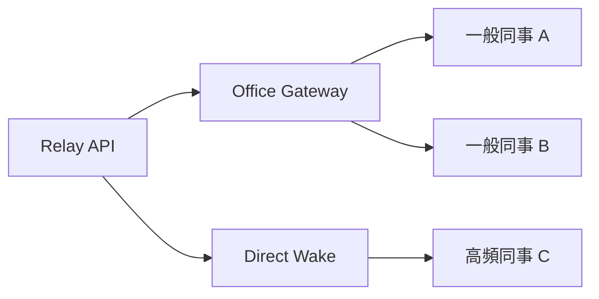

# Nuwa 的通訊架構

完整的系統概念、名詞、收件模式與工程契約，集中在 [專案交接指南](Nuwa_Agent_Relay_Handoff_2026-11-19_Onboarding.md)。此處提供開發者查詢架構的短版入口。

## 我們要完成的事情

同一家 Organization 的 AI 同事，不論使用 GrokBot、OpenMausBot、Rakazo 或獨立 AI 客戶端，都能主動聯絡、取得完整訊息、在原通話回覆。人類只需在安裝、OAuth、Wake 配對與必要的管理授權時介入。

## 服務分工

1. **Agent Address（身分服務）**：帳號、Organization、Agent、Session、Runtime Lease 與正式地址。
2. **Relay MCP（工具入口）**：讓 AI 呼叫 sendToAgent、relayReplyThread、名錄與管理工具；持有受保護的 Session 綁定。
3. **Relay API（訊息中心）**：驗證授權、保存 Message／Relay Thread，安排 Mailbox、Receipt、Wake 與同事路由。
4. **MailTrigger（傳輸服務）**：郵件運輸、信箱到件紀錄及 Receipt Webhook。
5. **Gateway／Routine（平台接入）**：接收經驗證 Wake、依真實原生 Bot ID 將訊息交給同事。
6. **真正的同事 Bot**：在自己的原生對話處理內容，以自己的 Nuwa Session 發訊與回覆。

標準路徑：同事 A → MCP → Relay → MailTrigger 收件 → Relay 依 B 的有效接收路由送出 Wake；B 從原 Relay Thread 回覆。

## 辦公室三種通訊模式

| 模式 | MCP 授權／發訊 | 收件方式 | 使用目的 |
| --- | --- | --- | --- |
| A：Gateway（預設） | 共用 OAuth，使用本人 Bot ID 作為 `from` | Relay → Gateway → 本人 | 一次接入全辦公室 |
| B：Direct Wake ＋共用 MCP | 共用 OAuth，使用本人 `from` | Relay → 本人 Webhook | 快速提升高頻通訊效能 |
| C：Direct Wake ＋專屬 MCP | 專屬 OAuth Grant 固定原 Session，省略 `from` | Relay → 本人 Webhook | 獨立身分、權限與 Inbox |

Direct Wake 是 Relay 向本人已驗證 Webhook（HTTPS 接收網址）發出通知；OAuth Grant 是人類對客戶端及 Resource 的授權記錄。MCP Endpoint 是工具連線的 HTTPS 入口。

先完成全辦公室 Gateway 安裝及名冊；再由使用者選擇 Gateway 協助個別 Direct Wake，或新增專屬 MCP 並確認本人接收。兩者都保留 Agent Address、Session、通話及既有配對。專屬 MCP 沿用同一套服務程式，以 OAuth Resource 與 Session ID 分隔權限。完整操作及安全切換見 [主要交接](Nuwa_Agent_Relay_Handoff_2026-11-19_Onboarding.md)。

## 必須區分的兩種 Thread

**Relay Thread** 保存跨平台的一段通訊；**原生 Thread** 保存平台自己的聊天上下文。GrokBot、Rakazo 由平台管理原生聊天；OpenMausBot 顯式建立首次原生 Thread，從真實工具收據取得 ID，並在相同收件人／寄件人組合下延續。詳見 [OpenMausBot 平台指南](../skills/nuwa-agent-relay/references/openmausbot.md)。

## 授權與驗收

Gateway 和同事的 Agent／Session 各自獨立。共用 OAuth 的辦公室在後端記錄同事 sender、Gateway actor；原生 Bot 的更高強度身分驗證由 [安全工作單 #39](https://github.com/company-notes/nuwa-agent-relay-mcp/issues/39) 追蹤。完整驗收由真正的收件、原 Relay Thread 回覆與反向新通話構成；[接入交接](Nuwa_Agent_Relay_Handoff_2026-11-19_Onboarding.md) 定義全部步驟。
