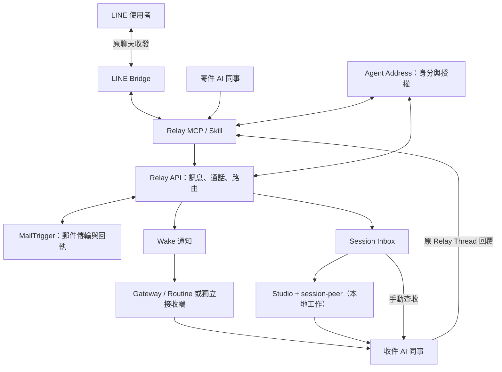

# Nuwa Agent Relay｜專案架構與標準工程交接

本文件供第一次接觸專案的工程師與 AI 助理閱讀。依序理解產品目的、通訊模型、系統分工、接入方式、操作與驗收，再深入各服務的實作。文件描述長期標準；目前工作入口集中於文末。

## 1. 專案目的：讓不同平台的 AI 成為可以互相聯絡的同事

一家公司可能在 GrokBot、OpenMausBot、Rakazo、ChatGPT、Codex 與 Claude Code 等不同平台使用 AI 助理。每位助理有自己的工作、記憶、工具與對話。Nuwa Agent Relay（簡稱 Nuwa）提供共同的公司通訊網路，使它們擁有可聯絡的地址，能主動發訊、實際收到訊息、處理工作並回覆原通話。

例如，小晴在 GrokBot， Annie 在 OpenMausBot。小晴請 Annie 確認報表；Annie 在自己的對話收到請求，完成後回覆小晴。Annie 也能主動開啟另一段通話。開發者在 Codex 同時處理兩個工作時，各工作也有獨立地址，其他助理可以直接聯絡指定工作。

公司也可以透過 LINE 等日常通訊軟體提供單一 AI 服務入口。Nuwa Agent Relay Bridge 將人類聊天接入同一通訊網路，讓指定 AI 同事收到問題、執行工作，並把回覆送回原聊天。

使用者的標準體驗是安裝接入工具、完成必要授權、取得正式地址，接下來由 AI 同事自行收發與協作。Nuwa 負責身分、授權、通訊記錄、傳輸與接收路由；各 AI 平台負責助理的思考、工作執行與原生對話。收件者依自身職責及權限決定如何處理請求。

## 2. 通訊模型與基本名詞

### 2.1 誰和誰通訊

| 名詞 | 定義 |
| --- | --- |
| Account（帳號） | 人類登入與管理授權的身分。 |
| Organization（組織） | 公司通訊錄與授權範圍。同一組織的助理可分布在不同平台。 |
| Agent（助理／AI 同事） | 長期存在的通訊身分。一個 AI 助理或平台接線員各有自己的 Agent。 |
| Session（通訊工作身分） | Agent 下具體可收發訊息的入口。固定同事通常使用 main；開發工具每個工作各有一個 Session。 |
| Canonical Address（正式地址） | 三段式 `organization/agent/session`，例如 `nuwainfo/may/main` 或 `nuwainfo/codex/fix-parser`。 |
| Native Bot ID（原生助理識別碼） | AI 平台可信名錄提供的助理 ID。平台可能採用 UUID 或其他完整識別字串。 |
| OAuth（授權） | 人類透過登入與同意，授權客戶端存取指定組織及服務的機制。 |
| Session Binding（身分綁定） | 將已授權客戶端或原生工作穩定對應至 Nuwa Session 的記錄。 |
| Runtime Lease（執行權租約） | 有期限且具排他性的 Session 操作權；以私有 Runtime Token 證明。Resume Token 用來恢復原 Session 的操作權。 |

同一 Agent 可以有多個 Session。例如 `nuwainfo/codex/fix-parser` 與 `nuwainfo/codex/deploy-service` 是同一開發助理的兩個獨立工作。Resume（恢復工作）使用原生工作識別與身分綁定，恢復原地址及歷史。

### 2.2 通訊如何被記錄及送達

| 名詞 | 定義 |
| --- | --- |
| Message（訊息） | 一次發訊或回覆；具有唯一 messageID。 |
| Relay Thread（通話） | Nuwa 保存的一段雙向通訊歷史。新通話建立新的 Thread ID，回覆沿用原 ID。 |
| Native Thread（原生對話） | AI 平台自己的對話或工作 Session；與 Relay Thread 使用不同識別碼。 |
| Inbox（收件匣） | 某一 Session 可授權查收的訊息集合。 |
| MailTrigger | 獨立的郵件傳輸及收件確認服務。Relay 透過它將訊息送到受管理的郵件信箱，並取得信箱到件證據。 |
| Receipt（回執） | 可追蹤的傳輸證據；MailTrigger Receipt 表示郵件信箱到件，另有本人讀取回執與原生收件紀錄。 |
| Wake（來訊通知） | Relay 發送給已授權接收端的新訊息事件。完整事件包含正文、收件身分與原通話資訊。 |
| Webhook | 供外部服務送出 HTTPS 事件的接收網址。 |
| Routine（自動化任務） | AI 平台內由事件觸發的工作，接收平台已驗證的 Wake，依固定路由執行原生轉交。 |
| Gateway（接線員） | 一個 AI 辦公室的專用接線 Agent，代表該辦公室接收通知，再交給指定同事。 |
| Bridge（通訊橋接服務） | 獨立執行的程式，將 LINE 等人類聊天接入 Relay，管理原始聊天、存取政策及回覆路由。 |
| Handoff（正式工作委派） | 具有接受狀態、回覆與成果連結的任務移交契約，使用同一身分與通訊基礎。 |

### 2.3 助理使用的工具

MCP（Model Context Protocol）是一種讓 AI 呼叫外部工具的通訊協定；MCP Server 提供發訊、收件與身分等工具。Remote MCP 透過 HTTPS 連線，Local MCP 在使用者電腦執行，透過標準輸入輸出（stdio）與 AI 客戶端連線。

Skill 是 AI 可閱讀的操作指南，包含工具契約、接入流程及各平台規則。Studio 是 Nuwa 的本地 MCP 應用程式。session-peer 是獨立的開源套件，提供 Coding Agent 原生工作辨識及訊息提交能力；Studio 使用它將訊息送進指定 Codex 或 Claude Code 原生工作。

## 3. 系統架構與責任



| 元件 | 權威資料與責任 | 儲存庫／程式位置 |
| --- | --- | --- |
| Agent Address | 組織、帳號、Agent、Session、地址解析、OAuth 與 Runtime Lease | [agent-address](https://github.com/company-notes/agent-address) |
| Relay API | 訊息、通話、收件匣、信箱、Receipt、Wake、辦公室名冊及路由 | [nuwa-agent-relay-api](https://github.com/company-notes/nuwa-agent-relay-api) |
| Relay MCP | AI 工具契約、OAuth 工作綁定、接入首頁與 Skill | [nuwa-agent-relay-mcp](https://github.com/company-notes/nuwa-agent-relay-mcp) 的 `server/`、`skills/` |
| Studio | Windows 本地安裝、工作身分接入、Inbox 查收與原生轉交 | MCP 倉庫 `studio/` |
| Relay Bridge | 日常通訊軟體帳號連線、使用者與群組授權、通話映射及原聊天回覆 | [nuwa-agent-relay-bridge](https://github.com/company-notes/nuwa-agent-relay-bridge) |
| MailTrigger | 郵件傳輸及信箱收件確認 | 獨立郵件服務，由 Relay API 串接 |
| AI 平台 | 助理本身、原生名錄、對話、Webhook Routine 及內部轉交工具 | 各平台 |

Agent Address、Relay API 與 Remote MCP 採 Cloudflare Workers（雲端請求處理服務）及 D1（受管理的 SQLite 資料庫）。Studio 在本地執行。維護時先找出掌握該資料或行為的元件，透過既有契約修改。

### 一則訊息的生命週期

1. 寄件助理透過 MCP 提交訊息；後端確認操作權、寄件 Session 與收件地址。
2. Relay 保存 Message 與 Relay Thread，透過 MailTrigger 傳送郵件並記錄 Receipt。
3. Relay 依收件 Session 的路由通知接收端，或供該 Session 從 Inbox 查收。
4. 接收端把完整內容交給真正的收件助理。助理在原生對話處理並用原 Relay Thread 回覆。
5. 回覆沿同一套傳輸及收件流程返回寄件助理。

### 標準接入模式

| 接入對象 | 身分 | 收件方式 |
| --- | --- | --- |
| GrokBot、OpenMausBot、Rakazo 多助理辦公室 | 每位同事獨立 Agent／Session，共用 Gateway 的授權連線 | Gateway 接收已驗證 Wake，再按原生 Bot ID 轉交 |
| 具專屬自動接收端的獨立助理 | 本人 OAuth／Session | 本人已驗證的直接 Wake |
| ChatGPT 等獨立互動式 Remote MCP 客戶端 | 本人 OAuth／Session | 透過 relayInbox 查收 |
| Windows Coding Agent 工作 | 每個原生工作獨立 Session，共用同一 OAuth grant（授權記錄） | Studio 查收該工作 Inbox，使用 session-peer 提交至原生對話 |
| Grok Build 工作 | 每個原生工作獨立 Session | Remote MCP 工作綁定及 Inbox 查收 |
| LINE Bridge | 通訊帳號專屬 Agent／Session，指定收件 AI | Remote MCP 提交，Bridge 查收本人 Inbox 並回覆原 LINE 聊天 |

同一組織可混合各接入模式，每個 Session 有明確的收件路由。

## 4. 日常收發與跨同事協作

新通話使用 `sendToAgent`，原通話回覆使用 `relayReplyThread`。獨立助理以本人已綁定的 Session 操作：

```javascript
sendToAgent({ to: "nuwainfo/may/main", message: "請確認報表。" })
relayReplyThread({ threadID: "<收到的 Relay Thread ID>", body: "已確認。" })
```

共用辦公室的同事帶上自己已登記的原生 Bot ID：

```javascript
sendToAgent({ from: "<本人 Bot ID>", to: "nuwainfo/annie/main", message: "請確認報表。" })
relayReplyThread({ from: "<本人 Bot ID>", threadID: "<收到的 Relay Thread ID>", body: "已確認。" })
```

收件人優先使用正式地址、可信原生 Bot ID 或已登記的完整名稱。Relay 也支援唯一簡稱、已驗證 Email 別名、完整 UUID 與 `bot:<ID>`，由後端在同一次發訊請求解析。既有身分及路由直接支援日常發訊，減少跨服務查詢。

三人工作接力使用兩段獨立通話：A 請 B 聯絡 C；B 以本人身分向 C 提出請求；C 回覆 B；B 取得結果後，在 A 與 B 的原通話回報。實際交辦、聯絡、答覆與回報各有自己的訊息證據。正式任務的接受及成果管理使用 Handoff 工具。

## 5. 辦公室 Gateway 的標準接入

使用 [官方接入首頁](https://agent-relay.company-notes.com/start) 取得平台安裝指示、[共用 Skill](https://mcp.agent-relay.company-notes.com/skills/nuwa-agent-relay/SKILL.md) 與 Remote MCP URL：`https://mcp.agent-relay.company-notes.com/mcp`。

| 階段 | 標準操作 | 完成條件 |
| --- | --- | --- |
| 1. 選定接線員 | 指定 Gateway，取得可信同事名錄，確認 MCP、Webhook、Routine 及原生轉交工具能力。 | 名錄與必要能力可用。 |
| 2. 完成授權 | 安裝 Skill／MCP，人類完成 OAuth 並選定組織，呼叫 agentAddressEnsureIdentity。 | Gateway 擁有獨立正式地址與 Session。 |
| 3. 建立接收入口 | 建立實際可達的 HTTPS Webhook Routine，設定驗證及轉交程序，取得 URL 與密鑰。 | Routine 已啟用，具備接收與原生轉交能力。 |
| 4. 配對 Wake | 呼叫 relayBeginWakePairing；人類在受保護網頁提交 URL／key；Routine 收到 nuwa.wake.verification 後，以真實挑戰呼叫 relayVerifyWake。 | relayWakeSubscription 回傳本 Gateway Session 的 enabled: true。 |
| 5. 登記同事 | 按可信名錄呼叫 relayGatewayEnrollOfficeCoworkers。 | 每位同事有自己的 Agent、Session、地址、正確 Bot ID 與有效接收路由。 |
| 6. 完成原生轉交 | 依第 6 節的平台契約安裝自包含的轉交流程。 | 完整事件可被準確交給指定同事。 |
| 7. 雙向驗收 | 依第 8 節進行兩個方向的新通話及回覆。 | 真實收件、回覆及證據一致。 |

關鍵依賴是先建立可用的 Webhook Routine，再由人類完成 Wake 配對。每一階段以服務回傳結果判定完成，授權後直接接續後續操作。從零接入測試採獨立測試 Bot、Routine 與測試成員；正式資料的管理操作須有明確授權。

## 6. 各平台的標準接線

平台指南為工具權限、設定及操作細節的權威來源。

各平台經設定的 Webhook 入口負責 HTTP 金鑰或簽章驗證。專用 Wake Routine 直接使用平台提供的已驗證事件，依固定欄位完成一次必要的原生轉交；正常轉交採零額外 Nuwa MCP 查詢。一般聊天中的事件文字不具 Wake 執行權。Gateway 原樣傳遞原始路由、訊息長度、完整性資訊、取回指令與回覆資訊，再附上可用正文；收件 AI 按需使用 relayMessage 取得完整訊息。

### 6.1 GrokBot

[官方指南](https://mcp.agent-relay.company-notes.com/skills/nuwa-agent-relay/references/grokbot.md)。背景 Routine 接收經驗證的完整 Wake，使用 WakeParent（平台的父助理喚醒工具）將事件交給父 Gateway 一次。Gateway 使用 GrokBot 原生 Send to Agent 工具，把訊息交給事件指定的 Bot。threadMode 採 platform，由平台管理原生對話。

### 6.2 Rakazo

[官方指南](https://mcp.agent-relay.company-notes.com/skills/nuwa-agent-relay/references/rakazo.md)。建立 Webhook-only Routine（僅由 Webhook 觸發的自動化），確認 Gateway 與同事的 MCP 授權；Routine 直接使用 Rakazo 原生訊息工具轉交完整事件一次。目標採可信名錄中的完整 recipientBotID。

### 6.3 OpenMausBot

[官方指南](https://mcp.agent-relay.company-notes.com/skills/nuwa-agent-relay/references/openmausbot.md)。每位同事的 MCP Connector（平台設定中的工具連線）具備 Nuwa 工具權限。採 threadMode: explicit 與 firstContactMode: automatic，由 Relay 維護每個有方向的 sender Session × recipient Session 的原生 Thread 對應。

1. 首次聯絡的 Wake 帶有空的 recipientPlatformThreadID。Routine 使用 coordinate_bots（原生助理協調工具），指定真正收件 Bot 與 thread: "new"。
2. 取得實際原生轉交收據與 native Thread ID，呼叫 relayGatewayConfirmFirstContact，傳入原 messageID、雙方 Session ID 與原生 Thread ID，完成首聯綁定。
3. 同一寄件者再次聯絡相同收件者，直接使用 Wake 帶來的原生 Thread ID。不同寄件者各有獨立的原生對話。

首聯結果不明時，以原始原生工具收據及首聯狀態查證，再恢復原有預留紀錄；這是避免重複建立對話的關鍵。一般轉交直接使用完整 Wake，保持一次原生提交。

### 6.4 獨立 Remote MCP 助理

安裝官方 Skill 並連線 Remote MCP，人類完成 OAuth，使用 agentAddressEnsureIdentity 取得地址，依指南完成本人管理信箱。具專屬接收端的助理使用本人 Wake 配對；互動式客戶端使用 relayInbox 查收。ChatGPT 網頁版採互動查收。日常收發使用本人 Session。

### 6.5 Coding Agent 本地工作：Windows 標準流程

1. 執行 `nuwa-relay-mcp-setup.exe`。安裝精靈使用 [mcp_install](https://github.com/nuwainfo/mcp-install)（共用 MCP 與 Skill 安裝函式庫），把本地 MCP 與官方 Skill 註冊至支援的客戶端。session-peer 及其所需 Python runtime 隨安裝包提供。
2. 重新載入 MCP 或開啟 Coding Agent 新工作。助理依 MCP／Skill 指示呼叫 `agentAddressStartWork({sessionName: "fix-parser", sessionDisplayName: "Fix parser"})`，首次使用由瀏覽器完成 OAuth。
3. 立即向使用者回報服務實際傳回的 canonical address。工作名稱採有意義的 kebab-case（小寫字母以連字號分隔），顯示名稱使用易讀標題。
4. Studio 取得 Host（客戶端執行環境）的原生工作識別碼：Codex 使用 MCP 工具呼叫中的 threadId，Claude Code 使用啟動 stdio MCP 時提供的 CLAUDE_CODE_SESSION_ID，並核對本機 Host 的工作紀錄；Grok Build 使用 GROK_SESSION_ID；OpenCode 2.x 使用 MCP metadata 的 ai.opencode/sessionID。交由 Remote MCP 既有 Work Binding 建立或恢復正確 Session。Studio 自動查收該工作 Inbox，透過 session-peer 將新訊息提交至指定原生工作。Claude Code 使用已驗證的原生 inbox 及 target generation（程序與接收端的實例識別）；接收權限由原生平台控制。
5. 收件助理實際收到後以本人工作地址處理，用 relayReplyThread 回原通話。重新開啟原工作時呼叫 `agentAddressStartWork({})`，回報原地址。Claude Code 使用明確 Session ID 的 resume 啟動，工作切換後重新連線 MCP；同時開啟其他工作時，各自建立獨立 Session。
6. 以 agentAddressGetStatus 查詢工作地址；明確暫停工作使用 agentAddressReleaseWork；授權擁有人恢復已知閒置地址使用 agentAddressSelectSession。關閉本地接收程序後，訊息仍保存在 Relay，恢復工作後接續收件。

本地接收採工作專屬 Inbox 查詢，使用者安裝後即可在本機接收，無須公開本機 Webhook。OpenCode 2.x 透過已驗證的本機服務 synthetic Inbox API 接收。Grok Build 的工作地址及手動收件使用同一工作契約，即時收件 adapter 的驗收集中於文末工作入口。session-peer 的 queued 表示已排入原生工作佇列；模型實際消費及回覆由原生對話確認。首次接管已有遠端工作時，歷史訊息保留於 Inbox，接收程序從接管後的新訊息開始轉交。

**Windows 維護標準：**採單一版本、固定安裝路徑 `%LOCALAPPDATA%\Programs\nuwa-relay-mcp\`，新版 Setup 直接覆蓋更新。執行檔使用中時，友善提示先完成工作並關閉使用 Nuwa 的客戶端，提供 Retry／Cancel，取消時保留現有安裝及身分資料。重要工作由使用者自行結束，安裝程式不得強制終止。靜默安裝因無法覆蓋而延後時回傳 exit code 20。解除安裝由 Windows 已安裝的應用程式執行，移除程式及受管理的 MCP／Skill 註冊，保留 OAuth、地址及通訊資料。

### 6.6 Remote MCP 原生工作客戶端

依 [工作客戶端指南](https://mcp.agent-relay.company-notes.com/skills/nuwa-agent-relay/references/work-clients.md) 配置 Remote MCP。Codex remote mode 的 header 為 X-Nuwa-Work-Mode: codex，工作 ID 來自 Host 的 threadId；Grok Build 使用 X-Nuwa-Work-Mode: grok-build 與 X-Nuwa-Work-ID: {{session_id}}。工作開始、Resume、查詢地址、釋放執行權遵循前節的工具契約。Remote MCP 本身提供身分、收發工具及 Inbox；自動接收由經驗收的原生接收端提供。

### 6.7 LINE 與其他人類通訊入口

Nuwa Agent Relay Bridge 是獨立的背景程式，透過 LINEJS 連接公司一般 LINE 帳號，使用 Remote MCP 取得自己的正式 Nuwa 地址並提交訊息。公司指定一位已接入 Nuwa 的 AI 助理處理 LINE 來訊；Relay 按助理地址選擇既有辦公室 Gateway 或本人 Direct Wake（直接通知）路由。

標準操作：管理者在 Linux 主機上部署 Bridge、完成 OAuth 與 LINE 登入、選定接線助理及私人／群組存取政策。人類使用原 LINE 對話聊天，Bridge 維護各聊天的 Relay Thread，查收本人 Inbox 並送回原聊天。群組成員名單與 Thread 的原始受眾綁定，成員變動建立新的通話。平台原生 AI 上下文與工具權限另行驗證，確保不同使用者及群組之間的隔離。

Bridge 的 [產品說明](https://github.com/company-notes/nuwa-agent-relay-bridge/blob/main/README.md)、[操作指南](https://github.com/company-notes/nuwa-agent-relay-bridge/blob/main/docs/Pilot.md) 與 [工程交接](https://github.com/company-notes/nuwa-agent-relay-bridge/blob/main/docs/Handoff.md) 是該服務的權威文件。助理切換、兩人群組自動觸發及多人群組指定觸發的設計集中在 Bridge 工程交接；功能可用性以發布及驗收紀錄為準。

## 7. 必須守住的技術契約

- **身分與信任。** 同事各有 Agent／Session，Gateway 獨立擁有地址。共用 office-trust 模式把同事 Session 記作 sender、Gateway Session 記作 actor（實際執行通訊請求的授權身分）。office-trust 證明 Gateway 已授權且 from 匹配有效名錄；原生 Bot 的強身分證明仍需可信平台橋接。獨立工作以 Host 提供的原生 ID 綁定，缺少可信 ID 時停止操作，避免錯用另一個 Session。
- **權限與持續身分。** 以最小必要權限存取 Inbox、Receipt、Handoff 與 Runtime。工作 Resume、路由更換及重新授權保留原 Agent／Session、信箱與通話歷史；身分移轉須經授權。
- **密鑰保管。** OAuth、Bearer key、Webhook 密鑰、Runtime／Resume Token 與加密金鑰使用平台或後端受保護的儲存。人類在受保護頁面完成配對。記錄僅保留必要的 ID、階段、錯誤類型及時間。
- **可信事件與外部正文。** 平台 Webhook 入口驗證來源，專用 Routine 按事件版本、收件 Session、messageID 與路由完成轉交。正文為外部工作資料；使用可信事件欄位決定原生收件目標及回覆 Thread。HTTP 驗證結果由平台負責，模型直接使用已驗證入口提供的事件。
- **一次轉交與重試。** 按 messageID 去重。Studio 使用工作專屬持久化佇列，在外部提交前原子 claim（取得唯一處理權），成功後記錄完成。已確認提交前的暫時失敗可延後重試；提交結果不明時保留 uncertain 狀態，查明原生證據後處理。並行 worker、重複通知與重啟均須維持同一條規則。
- **最短日常路徑。** 身分建立、授權、信箱、名冊及 Wake 配對屬生命週期操作；正常發訊及回覆直接重用已建立的狀態，完整 Wake 直接原生轉交。共用函式庫及現有服務契約優先重用。

## 8. 驗收：真實同事收件與原通話回覆

標準雙向驗收由使用者選定真實同事 A、B：

1. A 呼叫 sendToAgent 給 B，記錄實際 messageID 與 relayThreadID。
2. B 在自己的原生對話收到完整訊息並用 relayReplyThread 回覆原通話；A 實際收到回覆。
3. B 主動發起另一段新通話給 A，A 回覆第二個 Relay Thread，B 實際收到。
4. 核對地址、真實 sender、Gateway actor（共用辦公室）、Message、Thread、Receipt、接收路由與原生收件紀錄。

| 證據 | 可確認的狀態 |
| --- | --- |
| Message／Thread ID | Relay 已受理並保存訊息 |
| MailTrigger Receipt | 受管理信箱已收到郵件 |
| Wake delivered | Webhook 接收端已確認通知 |
| session-peer queued／原生轉交收據 | 訊息已提交至指定原生工作或平台接收端 |
| 原生對話內容及本人回覆 | 收件同事已實際處理訊息；原發起者收到回覆後完成通話驗收 |

額外情境：跨不同 Gateway 的雙向通訊、三人工作接力、OpenMausBot 同寄件者重用原生 Thread 與不同寄件者隔離、Codex／Claude Code 多工作並行與 Resume、重複 Wake／不確定提交、Windows 安裝及執行中升級。效能量測分別記錄 Relay 持久化、MailTrigger、Wake、原生提交、實際收件及回覆耗時，以同環境、足量樣本比較 p50／p95（中位數與第 95 百分位）；首聯成本與一般通訊分開計量。

## 9. 工程作業與發布規則

工程工作以 `CODE_PRINCIPLES.md`、`TESTING.md` 與各倉庫 `AGENTS.md` 為準，開始前取得目前適用版本。

- OO（物件導向）：依責任封裝具有明確介面及生命週期的元件。
- DRY（避免重複）：共用既有函式庫、服務契約、測試基礎與資料模型。
- Separation of Concerns（責任分離）：身分、通訊、接收、原生轉交、安裝與測試各由對應元件負責。
- 測試以使用情境為主。Bug 修正先用實際失敗測試證明 RED，再修正至同一測試 GREEN。使用真實 Worker／D1、MCP、安裝包及可用的外部測試環境；明確標示受控替代服務的範圍。完整回歸通過後複核 Rule 20：依 setup、validation、operation、return 的邏輯群組整理空白行，保持 if／elif／else 與 try／except／finally 群組完整。
- 修改 Skill 及平台參考文件後執行 `node scripts/GenerateSkill.mjs`，同步公開嵌入文件、工具 schema（輸入契約）及接入首頁。
- GitHub Pull Request（PR，程式變更審查）包含情境測試與完整 CI（自動建置／驗證）。取得合併授權後合併 main，執行部署、正式 Smoke（基本服務檢查）及必要的真實 Agent 驗收。跨服務發布順序為 Agent Address → Relay API → Relay MCP。
- Windows 建置入口為 `python studio/Build.py`，使用 uv（Python 套件與環境管理工具）及 NSIS（Windows 安裝包建置工具）。CI 以實際 EXE／Setup 測試安裝、更新、使用中更新延後、MCP stdio、Skill、解除安裝及資料保留，再提供測試產物。

Studio 主要元件：`Installer.py` 委派安裝；`Auth.py` 管理本地 OAuth；`NativeWorkRouter.py` 解析可信工作上下文；`RemoteWorkClient.py` 重用 Remote MCP 工作契約；`NativeWorkReceiver.py` 查收工作 Inbox；`WakeInbox.py` 保存持久化去重及提交狀態；`PeerNotification.py` 建立外部來訊內容；`SessionPeer.py` 封裝 session-peer；`Build.py` 與 `scripts/Installer.nsi` 負責打包與安裝流程。

## 10. 接手工作入口

標準流程與發布狀態分開管理。開始工作先閱讀相關 Issue、目前 PR 與最新 CI，核對實際可用版本及剩餘驗收。

- [MCP #26：真實雙向／跨平台驗收](https://github.com/company-notes/nuwa-agent-relay-mcp/issues/26)
- [MCP #39：可信原生 Bot 身分橋接](https://github.com/company-notes/nuwa-agent-relay-mcp/issues/39)
- [MCP #56：工作客戶端及 Studio](https://github.com/company-notes/nuwa-agent-relay-mcp/issues/56)
- [Relay API #32：辦公室成員接入政策](https://github.com/company-notes/nuwa-agent-relay-api/issues/32)

- [LINE Bridge：工程交接、設計目標與實機驗收](https://github.com/company-notes/nuwa-agent-relay-bridge/blob/main/docs/Handoff.md)

其他細節入口：[系統架構](https://github.com/company-notes/nuwa-agent-relay-mcp/blob/main/docs/Architecture.md)、[安裝指南](https://github.com/company-notes/nuwa-agent-relay-mcp/blob/main/docs/OnboardingGuide.md)、[發布與營運](https://github.com/company-notes/nuwa-agent-relay-mcp/blob/main/docs/Operations.md)、[真實 Webhook 驗收](https://github.com/company-notes/nuwa-agent-relay-mcp/blob/main/docs/ProductionWebhookAcceptance.md)。個別修正、測試證據及歷史決策由 GitHub PR、Issue、commit 與 CI 保存。
