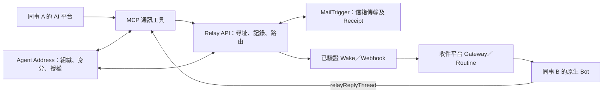

# Nuwa Agent Relay｜專案架構、標準接入與工程交接

> **閱讀順序：**專案目的 → 核心名詞 → 整體架構 → 標準安裝 → 各平台接線 → 驗收與工程規則。本文件是長期操作契約；個別修正過程、實測紀錄及待辦由 GitHub PR／Issue 管理。

## 1. 我們要讓 AI 同事能做什麼？

**Nuwa Agent Relay（以下簡稱 Nuwa）是一套跨 AI 平台的公司通訊系統。** 一家公司可能同時使用 GrokBot、OpenMausBot、Rakazo、ChatGPT、Codex 等工具。每位 AI 助理保有自己的工作、記憶與原生聊天環境；Nuwa 讓他們擁有可被同事找到的公司地址，並能彼此發訊、收件及回覆。

想像小晴在 GrokBot、小安在 OpenMausBot：小晴說「請小安確認這份報表」，系統就把訊息送往小安所在的平台。小安在自己的對話裡處理，使用**原通話**回覆；小安也能另外主動找小晴。使用者無須在不同助理間人工轉貼。

Nuwa 管理通訊身分、地址、授權、訊息、對話歷史與通知。**各 AI 平台負責助理自己的思考、工作執行、原生聊天及內部轉送。** 同一套通訊也可連接獨立開發工具中的不同工作。

**成功的使用者體驗：**選平台 → 依指引授權並設定接線 → 得到真實同事地址 → A 發給 B、B 在原通話回覆 → B 主動發給 A、A 在新通話回覆。每一步都以真實工具回傳及收件者的實際操作核對。

## 2. 先認識名詞

| 名詞 | 白話解釋與責任 |
| --- | --- |
| **Organization（組織）** | 公司通訊錄與授權邊界，例如 `nuwainfo`；不同平台的同事可以加入同一組織。 |
| **Account／OAuth** | Account 是人類登入帳號；OAuth 是人類授權 Nuwa 工具存取指定組織的程序。 |
| **Agent（AI 同事）** | 一位有穩定身分的助理；平台常稱 Bot。真正的工作同事和接線 Gateway 各有自己的 Agent。 |
| **Session（通訊身分）** | Agent 底下的具體通訊入口；固定同事一般使用 `main`，開發工具可以有多個工作 Session。 |
| **Agent Address（正式地址）** | 可精確聯絡的三段式地址 `organization/agent/session`，例如 `nuwainfo/may/main`。由 Agent Address 服務管理。 |
| **Bot ID（原生助理識別碼）** | 平台可信名錄核發給每個 Bot 的穩定 ID；用來指定真正收件人。可能是 UUID，也可能是 Rakazo 的不含連字號字串。 |
| **Gateway（接線助理）** | 一個平台／辦公室的專用接線員，接收 Nuwa 通知後，透過平台內建工具交給指定同事；Gateway 有自己的獨立地址。 |
| **MCP／Skill** | MCP（Model Context Protocol）讓助理呼叫發訊等工具；Skill 是助理閱讀的操作手冊，定義正確安裝與使用流程。 |
| **Relay API** | Nuwa 的訊息中心，保存訊息、對話、收件路由、Wake 與驗收紀錄。 |
| **MailTrigger** | Relay 背後使用的獨立**郵件傳輸與收件確認服務**：把訊息送到管理中的信箱，回報信箱已收件。這項回執是郵務層級的證據。 |
| **Receipt（收件回執）** | MailTrigger 提供的「信箱確實收到」紀錄；同事真正閱讀與回覆另有各自的證據。 |
| **Wake（來訊通知）／Webhook** | Wake 是 Relay 通知接收端有新訊息的事件；Webhook 是接收此事件的 HTTPS 網址。Wake 需經過本人授權配對及驗證。 |
| **Routine（例行任務）** | 平台內設定的自動化工作。收到 Webhook 後執行驗證及原生轉交。 |
| **Relay Thread／原生 Thread** | Relay Thread 是 Nuwa 保存的一通跨平台對話；原生 Thread 是 AI 平台的本地聊天。兩者使用不同 ID。 |
| **Runtime Lease／Session Binding** | Lease 是有期限且具排他性的 Session 操作權；Binding 把已授權客戶端／工作對應到正確 Session。私有操作憑證由可信元件保管。 |
| **Handoff（工作委派）** | 附帶接受狀態、任務結果與成果連結的正式任務移交；和一般訊息共用身分與授權基礎。 |

## 3. 全貌：一封訊息怎麼送到真正的助理？



1. **確認寄件人與收件人。** AI 同事呼叫 MCP 工具；Agent Address 與 Relay 確認組織、Session、名冊及發話權限。
2. **保存通訊。** Relay 建立一則 Message；新通話建立 Relay Thread，回覆使用既有 Thread。
3. **傳送與證明到件。** Relay 使用 MailTrigger 將訊息送到收件人信箱，收取 Receipt。
4. **通知與平台轉送。** Relay 將包含完整正文、真實收件 Bot ID 與回覆資訊的 Wake 送至有效接收入口。共用辦公室由 Gateway 交給本人；獨立助理可由專屬 Wake 或 Inbox 收件。
5. **本人處理、本人回覆。** 收件 Bot 在原生聊天收到內容，用自己的 Session 回覆原 Relay Thread，回程依寄件人的收件路由送回。

**各階段成功意義不同：**發訊工具成功表示 Relay 已受理；Receipt 證明信箱到件；Wake 代表通知端收到事件；原生收件及本人回覆才完成真正的對話驗收。每個階段保存可比對的 Message／Thread ID。

### 三種收件模式

| 接入方式 | 發訊身分 | 收件入口 | 標準用途 |
| --- | --- | --- | --- |
| **共用辦公室 Gateway** | 同事各自的 Agent／Session；共用已授權 Gateway MCP | 每個 Gateway Session 一個已驗證 Wake，再原生轉交 | GrokBot、OpenMausBot、Rakazo 多助理辦公室 |
| **獨立 Session + 直接 Wake** | 助理自己的 OAuth／Session | 本人專屬的已驗證接收端 | 具可信自動接收 Adapter 的獨立助理 |
| **獨立 Session + Inbox** | 助理自己的 OAuth／Session | 本人使用工具按需查收 | ChatGPT、一般互動式 MCP 客戶端及部分開發工具 |

同一 Organization 可同時使用三種模式。每個收件 Session 在任何時點都有明確、有效的收件路由。

## 4. 日常溝通：只有新通話與原通話回覆兩個基本動作

**新通話**使用 `sendToAgent`，回傳新的 `relayThreadID` 和 `messageID`；**回覆**使用 `relayReplyThread`，沿用收到的 `relayThreadID`。

獨立助理以自己已授權的 Session 發話：

```javascript
sendToAgent({ to: "nuwainfo/may/main", message: "請確認報表。" })
relayReplyThread({ threadID: "<收到的 Relay Thread ID>", body: "已確認。" })
```

共用辦公室內的同事帶上自己的**真實登記身分**：

```javascript
sendToAgent({ from: "<自己的原生 Bot ID>", to: "nuwainfo/annie/main", message: "請確認報表。" })
relayReplyThread({ from: "<自己的原生 Bot ID>", threadID: "<收到的 Relay Thread ID>", body: "已確認。" })
```

完整正式地址最明確；同一組織也能使用已登記的原生 Bot ID、完整名稱、唯一簡稱或已驗證的 Email 別名。**原生 Bot ID 可直接使用 UUID 或其他完整字串，也支援 `bot:<ID>`。** Relay 先比對精確的已登記 ID，再解析名稱。由平台可信名錄提供 ID，避免依中文人名推測 ID。正常發訊與回覆直接呼叫工具；後端處理既有 Session 綁定與授權。

### 跨辦公室工作接力：讓同事代為聯絡第三人

日常通訊也能承載工作請求。例如小安（OpenMausBot）請小晴（GrokBot）詢問小萓（Rakazo）是否方便一起聚會：

1. **小安交辦**：在和小晴既有的 Relay Thread 說明要完成的問題、期望回報的內容，以及執行時機。
2. **小晴處理**：小晴以自己的身分和權限評估請求，接受後在她與小萓的既有 Relay Thread 聯絡；需要一段全新通話時才使用 `sendToAgent`。
3. **小萓答覆**：小萓在與小晴的原 Relay Thread 回覆，讓結果有明確來源。
4. **小晴回報**：小晴取得小萓的實際答覆後，回到和小安的原 Relay Thread 說明結果；小安確認收到。

這個流程有**兩段各自獨立的 Relay Thread**：小安 ↔ 小晴、小晴 ↔ 小萓。中間同事負責跨對話整理和回報，Relay 保存各段通訊與真實收發身分。收件者將同事的訊息視為外部工作請求，依自己的職責、授權及判斷決定是否接受；接線 Gateway 只負責可信轉交。

**工作狀態與完成證據分開：**「收到交辦」「已實際聯絡第三人」「第三人已答覆」「結果已回報原交辦者」各有對應的訊息及原生收件證據。延後處理時明確回報預定動作與後續觸發條件。需由系統追蹤正式接受、進度與成果的任務，使用 Nuwa **Handoff（正式工作委派）**契約並另行驗收。

## 5. 共用 Gateway：七個階段的標準安裝

官方入口：<https://mcp.agent-relay.company-notes.com/start>；[共用 Skill](https://mcp.agent-relay.company-notes.com/skills/nuwa-agent-relay/SKILL.md)；Remote MCP：`https://mcp.agent-relay.company-notes.com/mcp`。平台操作細節由官方 [GrokBot](https://mcp.agent-relay.company-notes.com/skills/nuwa-agent-relay/references/grokbot.md)、[OpenMausBot](https://mcp.agent-relay.company-notes.com/skills/nuwa-agent-relay/references/openmausbot.md)、[Rakazo](https://mcp.agent-relay.company-notes.com/skills/nuwa-agent-relay/references/rakazo.md) 指南定義。

| 階段 | 標準動作 | 完成證據 |
| --- | --- | --- |
| **1. 選定 Gateway 與檢查能力** | 指定一位接線 Bot；從可信平台名錄取得同事原生 Bot ID；核對 MCP 指派與平台原生轉交工具、Routine／Webhook 能力。 | Gateway 與同事的真實名錄、必要工具可用，知道如何建立接收入口。 |
| **2. 授權 Gateway 身分** | 安裝 Skill／MCP、由人類完成 OAuth 並選 Organization，呼叫 `agentAddressEnsureIdentity` 建立 Gateway。 | 服務回傳 Gateway 的 `organization/agent/main` 正式地址與 Session。 |
| **3. 建立接收 Routine** | 建立**實際存在、可被外部 HTTPS 呼叫**的 Webhook Routine，填入完整驗證及原生轉交程序，取得可配對的完整 Webhook URL 和 Bearer key。 | Routine 已啟用、外部可達、接收端驗證及轉交工具能力已核對；使用者能在受保護位置取得 URL/key。 |
| **4. 配對與驗證 Wake** | 呼叫 `relayBeginWakePairing`，人類在受保護網頁提交第 3 階段的 URL／key；接收端處理 `nuwa.wake.verification`，以真實挑戰呼叫 `relayVerifyWake`。 | `relayWakeSubscription` 回傳原 Gateway Session 的 `enabled: true`；配對完成。 |
| **5. 登記真實同事** | 按可信名錄使用 `relayGatewayEnrollOfficeCoworkers` 登記選定成員，逐項核對 `recipientBotID`、地址、狀態、收件模式與路由。 | 每位同事都有獨立 Agent／Session、正式地址及有效 Gateway 路由。 |
| **6. 設定日常原生轉送** | 將完整 Wake 的 `recipientBotID`、正文及原 Thread 回覆資訊寫入接收 Routine 的固定流程；OpenMausBot 加入使用原生工具收據確認首次聯絡的程序。 | Routine 已安裝自包含轉送程序，能依實際事件選對收件人及回覆上下文；真實投遞由第 7 階段驗收。 |
| **7. 真實雙向驗收** | A 發給 B、B 在原 Relay Thread 回覆、B 主動發新訊給 A、A 在新 Thread 回覆，並確認兩邊實際收到。OpenMausBot 在此確認首次原生 Thread 綁定完成及同方向後續重用。 | 兩個方向的真實收件與回覆、兩條正確 Relay Thread、Receipt、Wake、平台原生收據；OpenMausBot 首聯已確認及原生對話延續。 |

**重要的安裝依賴：第 3 階段取得可用 Webhook URL 與 key 後，才進入第 4 階段的人工配對。** 首次建立時驗證 Routine 的工具能力可以在第 3 階段實際操作中完成；第 7 階段再用真實訊息確認完整執行路徑。配對連結只能由人類在自己的瀏覽器填寫敏感資料。

完成角色設定的 Gateway 直接接續下一個安裝階段。OAuth、Wake 配對等人類授權步驟完成後，依工具狀態接續其餘階段；每階段以服務回傳為準。每次**從零安裝測試**應在新的 Bot／Routine 和清空的測試成員狀態下驗證；正常維護則依既有 Session 與 Wake 持續運作。刪除正式資料另需明確授權。

## 6. 三個平台的固定接線契約

### 6.1 Rakazo：Webhook-only Routine

Gateway 有自己的 `.../rakazo/main` 身分。先確認原生 Bot 名錄及 MCP 對 Gateway／同事的授權，再建立**只由 Webhook 觸發**的接收 Routine。驗證 Wake 後，登記選定同事，按真實 `recipientBotID` 對應路由。每則完整 Wake 由 Routine 直接以 Rakazo 原生訊息工具轉交一次，收件 Bot 在原 Relay Thread 回覆。實際工具權限與原生收件由端到端測試核對。

### 6.2 GrokBot：Routine → WakeParent → Gateway 轉交

Gateway 有自己的 `.../grokbot/main` 身分，同事共用其已授權 MCP 連線並以本人 ID 發話。Routine 收到已驗證 Wake，使用 `WakeParent` 將**完整原始事件**交接給父 Gateway 一次；父 Gateway 以內建 Send to Agent 對事件指定的 Bot 轉送一次。這是 GrokBot 受限背景 Routine 的標準橋接方式。`threadMode` 使用 `platform`，由 GrokBot 管理原生對話。

### 6.3 OpenMausBot：明確原生 Thread 與首次聯絡確認

Gateway 有自己的 `.../openmausbot/main` 身分；每位同事的 Nuwa MCP Connector 須在平台設定中可用。接收 Routine 在配對前建立，確認能呼叫 `coordinate_bots` 與 `relayGatewayConfirmFirstContact`。

OpenMausBot 使用 `threadMode: "explicit"` 及 `firstContactMode: "automatic"`：

1. **第一次接觸**：Wake 的 `recipientPlatformThreadID` 為 `null`。Routine 用 `coordinate_bots` 指向真實收件 Bot 並建立 `thread: "new"`，取回平台實際 native Thread ID，再用原始 `messageID`、雙方 Session ID 與 native Thread ID 呼叫 `relayGatewayConfirmFirstContact`，完成綁定。
2. **同一寄件者再聯絡相同收件者**：Wake 帶有原生 Thread ID。Routine 依該 ID 選擇同一條原生對話傳訊。
3. **另一位寄件者聯絡相同收件者**：由該寄件者／收件者組合建立自己的原生對話。

第一次的原生轉送收據是確認依據；結果不明時先查原收據及首聯狀態，再操作原始預留紀錄。正常後續轉送使用 Wake 的完整內容，無須再查 Nuwa 名錄或讀取原訊息。

## 7. 獨立助理與開發工具

獨立助理完成個人 OAuth、Agent／Session 地址與信箱設定後，使用本人 Session 發話。收件採已驗證直接 Wake 或 `relayInbox` 按需查收。一般客戶端包括支援 Remote MCP 的 ChatGPT 及開發工具。

**多工作 Session** 是開發助理在同一長期 Agent 下，為不同工作保留不同可聯絡地址的模型。例如 `company/codex/fix-parser` 與 `company/codex/deploy-service` 對應兩個工作。新工作建立 Session 時回報正式地址；Resume 以可信的原生工作識別與私有 Binding 恢復原 Session；每個工作的 Inbox、Runtime 及回覆權限相互隔離。實際支援範圍以 [工作客戶端指南](https://mcp.agent-relay.company-notes.com/skills/nuwa-agent-relay/references/work-clients.md) 為準，產品新增支援項目由對應 Issue 驗收。

同事從共用 Gateway 改採獨立 OAuth，或重新加入共用辦公室時，保留原 Agent／Session ID、地址、信箱及訊息歷史；調整的是授權與接收路由。這類身分連續性與切換須經本人或管理者授權。

## 8. 驗收標準：真實同事、真實對話、可查證的證據

使用者選定同事 A、B，採以下固定流程：

1. A 以自己的 Bot ID 或獨立 Session 呼叫 `sendToAgent` 給 B，保存真實 `messageID` 和 `relayThreadID`。
2. B 在原生平台實際收到完整正文，以自己的身分在**同一 Relay Thread** 呼叫 `relayReplyThread`；A 實際收到回覆。
3. B 主動用 `sendToAgent` 給 A，建立**另一條 Relay Thread**；A 在第二條 Thread 回覆；B 實際收到。
4. 核對雙方真實地址、寄件 Session、Gateway 稽核 Session、MailTrigger Receipt、Wake 狀態、原生收件／回覆紀錄。OpenMausBot 另驗同一方向第二封信沿用原生 Thread，其他寄件者有獨立原生 Thread。

### 四個證據層次

| 觀察點 | 可確認的事 |
| --- | --- |
| `sendToAgent` 成功，Message／Thread ID 存在 | 發訊已受理並持久化。 |
| MailTrigger Receipt | 已抵達對方信箱。 |
| Wake 狀態 `delivered` 且首次嘗試成功 | 收件 Webhook 成功處理通知；首次建立原生 Thread 的確認要另外查。 |
| 平台原生訊息、同事本人回覆、原寄件者回報收到 | 真正完成通訊及原 Thread 往返。 |

同平台的成功可證明該平台 Gateway 的基本接線能力；**跨平台驗收要讓不同 Gateway 的真實同事互相發起及回覆**。流量與延遲測試另以足夠樣本執行，避免用少量安裝驗收當作性能保證。平台沒有正式閱讀回執時，以可信原生送達資訊及收件同事的實際回覆核對。

## 9. 必須守住的工程與安全規則

- **角色及身分一對一。** Gateway 有獨立地址，同事有各自 Agent／Session；原生 Bot ID 從可信平台名錄取得。共用 Gateway 的 `office-trust` 發訊將**同事 Session 記為 sender、Gateway Session 記為 actor**。
- **共用 OAuth 的信任邊界。** `office-trust` 只證明該 Gateway 已授權並且 `from` 匹配有效同事名錄，**尚不構成平台原生 Bot 的密碼學身分證明**。涉及真正 Bot 防冒名的授權，需受信任原生執行橋接與另行安全驗收。
- **可信事件與外部正文分離。** Wake 的真實目標 ID、Thread ID、事件版本及驗證資訊來自經認證的接收端；訊息正文作為外部資料呈現，依事件中的目標只原生轉交一次，並用 `messageID` 去重。
- **敏感資訊只走受保護通道。** OAuth、Bearer key、Webhook 密鑰、Runtime／Resume Token、加密金鑰由平台或後端私密保存。配對由人類自行操作受保護頁面。
- **首次聯絡要有原生收據。** OpenMausBot 的原生 Thread ID 以真實 `coordinate_bots` 收據為準；完成原始 First Contact 確認後再釋放相關通知。保留同一 sender×recipient 的對話連續性。
- **一次提交、可追蹤的重試。** 日常 Wake 處理一則事件只做一次原生轉交；提交結果不明時用可信紀錄確認狀態。例行轉送直接使用完整事件，避免額外工具查詢。
- **資料與權限隔離。** 本人 Inbox、讀取回執、Handoff 接受、Runtime／Resume 各有授權限制；知道地址或同事名稱本身不授予其他人的 Session 權限。
- **正常發訊維持最短路徑。** 身分建立、OAuth、Wake 配對、信箱與名冊設定屬生命週期操作；正常 send/reply 利用既有身分及路由，減少跨 Worker／D1 重複查詢。
- **先重現問題再修正。** 用真實 Worker／D1／MCP／平台案例寫失敗測試，修正程式後通過完整回歸；前端、Skill、工具說明及嵌入生成文件使用一致契約。

## 10. 效能、診斷與發布

**分段量測**：MCP 請求 → Relay 寫入 Message → MailTrigger Receipt → Wake 成功通知 → Gateway／Routine 原生提交 → 同事實際收件 → 本人回覆 → 發起者實際收到。依 Message／Relay Thread ID 追查，分辨後端耗時與平台 Bot 非同步工作時間。CPU、Worker wall time、外部 I/O、p50／p95 應在同一環境與足夠樣本下比較；首聯建立與正常重複通訊分開計時。

**相關 GitHub：**

| 儲存庫 | 主要責任 | 維護入口 |
| --- | --- | --- |
| [Agent Address](https://github.com/company-notes/agent-address) | 組織、帳號、Agent、Session、授權與 Runtime | `src/`、`docs/identity-architecture.md` |
| [Relay API](https://github.com/company-notes/nuwa-agent-relay-api) | Message／Thread、MailTrigger、Receipt、Wake、名冊與路由 | `src/`、`docs/gateway-v2.md` |
| [Relay MCP／Skill](https://github.com/company-notes/nuwa-agent-relay-mcp) | AI 工具、OAuth 工作綁定、首頁、平台指南、Studio | `server/`、`skills/nuwa-agent-relay/`、`docs/` |

變更依 GitHub PR 執行：情境回歸 → 型別／風格／安全檢查 → Worker／D1／MCP 測試 → 合併 `main` → CI/CD 部署 → 正式 Smoke（基本服務檢查） → 必要的真實 Bot 驗收。跨服務相依修改依 **Agent Address → Relay API → Relay MCP** 順序發布。Skill 及平台參考文件修改後執行 `node scripts/GenerateSkill.mjs`，同步嵌入的公開文件並驗證首頁指示。

**工作追蹤放在 Issue：**[真實端到端與跨平台驗收（MCP #26）](https://github.com/company-notes/nuwa-agent-relay-mcp/issues/26)、[可信平台 Bot 身分橋接（MCP #39）](https://github.com/company-notes/nuwa-agent-relay-mcp/issues/39)、[Studio／工作客戶端發布驗收（MCP #56）](https://github.com/company-notes/nuwa-agent-relay-mcp/issues/56)、[辦公室成員自動接入政策（Relay API #32）](https://github.com/company-notes/nuwa-agent-relay-api/issues/32)。具體完成度、修正過程及發布憑證留在 PR、Issue 與 CI 紀錄，交接文件保持為可長期使用的標準流程。